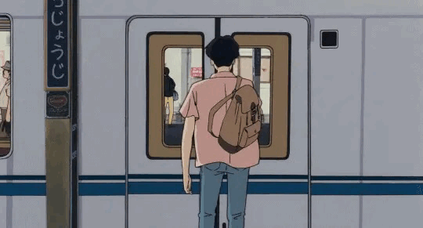

  

# Hi, I'm Mohammed Fouad Mahkouka 👋

**Senior Full-Stack Engineer · PhD Researcher in AI Security** — Béchar, Algeria

I build production web platforms end to end, and I research how to make machine-learning
detectors small, fast and reliable enough to ship. 5+ years turning client requirements into
deployed products: e-commerce, dashboards, booking and payment systems.

- 🏗️ **Engineering:** TypeScript, Next.js (App Router, Server Actions), React, Vue, Node.js, Python/Flask
- 🗄️ **Data & backend:** PostgreSQL, Prisma, Firebase, Payload CMS, Directus, Better Auth, REST APIs
- 💳 **Integrations:** payment gateways (MyFatoorah), Telegram bots, headless CMS
- 🔬 **Research:** LLM-generated phishing detection, domain adaptation, model compression (distillation + INT8) for CPU deployment
- 🎓 **Teaching:** lab instructor (TP) for Master's courses in AI and data analysis

📫 Open to senior full-stack roles, freelance projects and research collaborations.

 

---

### 🔬 Research

| Project | What it shows |
|---|---|
| [**llm-phishing-shift**](https://github.com/F0u4d8/llm-phishing-shift) | *When Lightweight Phishing Detectors Meet Unseen LLMs and Languages: A Label-Free Domain Adaptation Study.* **CSNT 2026.** CPU-only detector tested across generator, language and channel shift. |
| [**difraud-compression-study**](https://github.com/F0u4d8/difraud-compression-study) | Compressed transformers for multi-risk consumer protection: distillation + dynamic INT8 quantization, cross-risk transfer, calibration and CPU inference cost on DIFrauD. |

### 🚀 Selected engineering work

| Project | Stack | |
|---|---|---|
| [**smartMain**](https://github.com/F0u4d8/smartMain) | Next.js 15, Prisma, Server Actions | [live](https://smart-main.vercel.app) |
| [**AIALPHABET Dashboard**](https://github.com/F0u4d8/AIALPHABET-DASHBOARD-frontend) + [backend](https://github.com/F0u4d8/AiAlphabet-backend) | Next.js · Python | [live](https://aialphabet-dashboard-frontend-s4oz.vercel.app) |
| [**next15-betterAuth-boilerplate**](https://github.com/F0u4d8/next15-betterAuth-boilerplate) | Next.js 15, Better Auth, T3 | [live](https://next15-better-auth-boilerplate.vercel.app) |
| [**myFatoorah-blesta-gateway**](https://github.com/F0u4d8/myFatoorah-blesta-gateway) | PHP · payment-gateway module for Blesta | |

Plus several private client platforms (e-commerce, CMS-driven sites, booking systems) built with Next.js, Vue and Payload CMS.

### 🧰 Tech

